  
  
  
  

  <b>Développeur fullstack</b> · MSc Cybersécurité à Epitech Paris · Robotique &amp; vision industrielle 
  Alternance · Freelance · CDD — disponible dès maintenant · Paris / Lyon, mobile partout en France

<b>English version</b>

 

**Hi, I'm Damien Isaac PARAISO, a fullstack developer.** I build custom websites and web apps, from mockup to production: showcase sites, online booking, business tools. Three years of production code between Gabon and France. I'm now studying for an **MSc in Cybersecurity at Epitech Paris**, after a bachelor's degree in **robotics & industrial vision** (Université de Nîmes).

Open to **work-study (alternance), freelance missions and fixed-term contracts**: based in Paris / Lyon, mobile anywhere in France, remote or on-site. Full portfolio in six languages: [ydapi.fr](https://ydapi.fr)

 

<b>01 — À PROPOS</b>

## Du Gabon à la France

Je crée des sites et des applications sur mesure pour les entreprises et les indépendants : sites vitrines, réservation en ligne, outils métier. Trois ans de code en production, entre le Gabon et la France. Je travaille à distance ou sur place.

Aujourd'hui en **MSc Cybersécurité à Epitech Paris**, après une licence pro **Robotique & vision industrielle** à l'Université de Nîmes, je cherche une **alternance**, une mission **freelance** ou un **CDD**.

<table>
  <tr>
    <td align="center" width="220"><h3>4+</h3>ANS&nbsp;D'EXPÉRIENCE</td>
    <td align="center" width="220"><h3>8+</h3>LANGAGES&nbsp;APPRIS</td>
    <td align="center" width="220"><h3>7</h3>PROJETS&nbsp;LIVRÉS</td>
  </tr>
</table>

 

<b>02 — PROJETS</b>

## Ce que j'ai construit

Des projets menés jusqu'au bout, pour l'école comme pour de vrais clients.

<table>
  <tr>
    <td width="50%" valign="top">
      01 · 2026 · PROJET CLIENT
      <h3><a href="https://pauleackerman.com">Portfolio Paule Ackerman</a></h3>
      Portfolio et back-office d'une social media manager à Libreville, conçu pour qu'elle le fasse vivre seule : publications, créations, montages vidéo, études de cas et messagerie intégrée.  
      API Express en serverless sur Vercel, upload signé direct vers Cloudinary (jusqu'à 100 Mo sans exposer la clé), anti-spam en base avec empreinte HMAC de l'IP.  
      <code>Node.js</code> <code>React</code> <code>Express</code> <code>MongoDB</code> <code>Cloudinary</code> <code>JWT</code> <code>Vercel</code>  
      <a href="https://pauleackerman.com">Voir en ligne</a> · <a href="https://github.com/yortze/pauleackerman">Code</a> · <a href="https://ydapi.fr/projets/portfolio-paule-ackerman">Dossier</a>
    </td>
    <td width="50%" valign="top">
      02 · 2026 · PROJET CLIENT
      <h3><a href="https://andersontattoo.vercel.app">Anderson Tattoo</a></h3>
      Site vitrine, réservation en ligne et back-office pour un atelier de tatouage à Libreville. Le client choisit un créneau, verse un acompte par Mobile Money, et l'atelier suit chaque rendez-vous depuis son espace privé.  
      Double réservation impossible grâce à un index unique en base, créneau libéré sans acompte sous 48 h, photos d'inspiration effacées trois mois après le rendez-vous.  
      <code>React 19</code> <code>TypeScript</code> <code>Express</code> <code>MongoDB</code> <code>Cloudinary</code> <code>Brevo</code>  
      <a href="https://andersontattoo.vercel.app">Voir en ligne</a> · <a href="https://ydapi.fr/projets/anderson-tattoo">Dossier</a> · <a href="https://ydapi.fr/blog/reservation-en-ligne-salon-tatouage-libreville">Article</a>
    </td>
  </tr>
  <tr>
    <td width="50%" valign="top">
      03 · 2026 · PROJET PERSONNEL
      <h3><a href="https://github.com/yortze/agent-freelance">Jarvis</a></h3>
      Agent IA de prospection freelance : il cherche des missions, repère les sites à refaire, les audite, écrit aux prospects, répond et relance, puis me prévient quand une décision me revient. Je lui parle à voix haute depuis son tableau de bord.  
      Garde-fous écrits dans le code : vingt premiers contacts et relances par jour au plus, deux relances par client, « STOP » respecté, aucun engagement sur un prix, un contrat ou une date.  
      <code>Python</code> <code>FastAPI</code> <code>Claude API</code> <code>SMTP / IMAP</code> <code>PageSpeed Insights</code> <code>Web Speech API</code>  
      <a href="https://github.com/yortze/agent-freelance">Code</a> · <a href="https://ydapi.fr/projets/jarvis">Dossier</a>
    </td>
    <td width="50%" valign="top">
      04 · 2026 · PROJET PERSONNEL
      <h3><a href="https://ydapi.fr">Portfolio ydapi.fr</a></h3>
      Portfolio multipage en six langues, avec son API, sa console d'administration et un atelier où écrire et lancer du code sans quitter la page. Tout le contenu se modifie en ligne, sans redéployer.  
      Chaque exécution dans un Worker neuf, Python via Pyodide (WebAssembly), iframe isolée ; session httpOnly et jeton anti-CSRF ; images réencodées en WebP sans GPS ; visites par pays sans stocker une seule IP.  
      <code>React 18</code> <code>TypeScript</code> <code>Vite</code> <code>Tailwind CSS</code> <code>Express</code> <code>MongoDB</code> <code>Pyodide</code>  
      <a href="https://ydapi.fr">Voir en ligne</a> · <a href="https://ydapi.fr/projets/portfolio">Dossier</a>
    </td>
  </tr>
  <tr>
    <td width="50%" valign="top">
      05 · 2022 · SOGAC TRANSIT
      <h3>App Gestion Douane</h3>
      Le logiciel qui suit les marchandises entrant et sortant d'un entrepôt sous douane, utilisé tous les jours depuis 2022. Aucune erreur permise : marchandises réelles, documents officiels.  
      Vérifications à chaque étape, historique de toutes les opérations, beaucoup de tests. Code privé, logiciel utilisé en entreprise.  
      <code>Java</code> <code>SQL</code> <code>MySQL</code>  
      <a href="https://ydapi.fr/projets/gestion-douane">Dossier</a>
    </td>
    <td width="50%" valign="top">
      06 · 2024 · ESGIS GABON
      <h3><a href="https://github.com/yortze/GabChat">GabChat</a></h3>
      Une messagerie Android qui fonctionne sans internet : les téléphones connectés au même Wi-Fi se détectent tout seuls et discutent en direct, sans serveur central.  
      <code>Kotlin</code> <code>Android SDK</code>  
      <a href="https://github.com/yortze/GabChat">Code</a> · <a href="https://ydapi.fr/projets/gabchat">Dossier</a>
    </td>
  </tr>
  <tr>
    <td width="50%" valign="top">
      07 · 2026 · SOGAC TRANSIT
      <h3><a href="https://github.com/yortze/SOGAC-Transit">Site vitrine SOGAC</a></h3>
      Le site officiel d'une société de transport et de douane au Gabon : un métier complexe expliqué avec des mots que tout le monde comprend, sur téléphone comme sur ordinateur.  
      <code>HTML/CSS</code> <code>JavaScript</code>  
      <a href="https://github.com/yortze/SOGAC-Transit">Code</a> · <a href="https://ydapi.fr/projets/sogac-vitrine">Dossier</a>
    </td>
    <td width="50%" valign="top">
      ET AUSSI SUR GITHUB  
      <a href="https://github.com/yortze/rebond-gmail"><b>rebond-gmail</b></a> — extension Chrome pour Gmail : envoi programmé, relance si pas de réponse, suivi des ouvertures.  
      <a href="https://github.com/yortze/edop"><b>edop</b></a> — site vitrine et back-office d'expédition aérienne et maritime France / Gabon.  
      <a href="https://github.com/yortze/cartouche"><b>cartouche</b></a> — lanceur de PKG PS4/PS3 pour shadPS4 et RPCS3, interface web locale en Python.  
      <a href="https://github.com/yortze/Module-Gestion-des-Absences-ESGIS-Gabon"><b>Gestion des absences</b></a> — module React ajouté à l'application web de l'ESGIS Gabon.  
      <a href="https://github.com/yortze/devops-capstone-project"><b>devops-capstone-project</b></a> — projet DevOps du certificat IBM.
    </td>
  </tr>
</table>

 

<b>03 — COMPÉTENCES</b>

## Ce que je sais faire

  

Le niveau est annoncé honnêtement, comme sur le portfolio : 26 compétences, 6 familles, 15 avancées ou expertes.

| Famille | Maîtrise | Solide | À l'aise | Bases |
|:--|:--|:--|:--|:--|
| **Langages** | Java | JavaScript · Kotlin · SQL · HTML/CSS | Python · PHP · C/C++ | |
| **Frameworks** | React | Android SDK | Node.js · Spring Boot · JavaFX | JDBC |
| **Outils & données** | | Git · Linux · MongoDB · MySQL | Docker | |
| **Cybersécurité** | | Kali Linux | | |
| **Robotique & vision** | | Robotique · Traitement d'image · Open eVision | HALCON · Programmation d'automates | |
| **Photo & vidéo** | | | Adobe Photoshop | |

 

<b>04 — PARCOURS</b>

## De Libreville à Nîmes

**Expérience**

| Période | Poste | Entreprise |
|:--|:--|:--|
| 01/2025 — 08/2025 | **Développeur fullstack** | SOGAC Transit, dépôt sous douane · Libreville, Gabon |
| 04/2022 — 01/2023 | **Stage développement fullstack** | SOGAC Transit, gestion logistique · Libreville, Gabon |

**Formation**

| Période | Diplôme | École |
|:--|:--|:--|
| 2026 — en cours | **Master of Science Cybersécurité** | Epitech Paris |
| 2025 — 2026 | **Licence pro Robotique & vision industrielle** | Université de Nîmes |
| 2023 — 2025 | **Licence Génie logiciel** | ESGIS Gabon |
| 2022 — 2023 | **BTS Informatique et réseau** | Institut technologique d'Owendo, Gabon |

**Certification**

| Date | Certification | Organisme |
|:--|:--|:--|
| 02/2026 | **Google Data Analytics Certificate** | Coursera × Google · [vérifier](https://coursera.org/verify/professional-cert/23H0QOVFIY3Z) |

 

<b>05 — CYBERSÉCURITÉ & SUPPORT IT</b>

## Sécuriser, dépanner, accompagner

Des labs et des CTF pour apprendre, avec un entraînement régulier sur [TryHackMe](https://tryhackme.com/p/Ydapi) et Kali Linux, et deux façons de travailler avec moi :

- **Audit de sécurité d'un site ou d'une application** : revue des points d'entrée (formulaires, comptes, API), rapport classé par gravité avec les correctifs à appliquer, point de suivi un mois après.
- **Support informatique et maintenance** : dépannage du poste de travail, du réseau et des comptes ; mises à jour, sauvegardes et surveillance ; petites évolutions et corrections sur vos sites.

> Je ne teste que des environnements où j'y suis autorisé : labs, CTF et périmètres définis par écrit avec le client.

 

<b>06 — FREELANCE</b>

## Ce que je peux faire pour vous

| Offre | Ce qui est compris | À partir de |
|:--|:--|--:|
| **Site vitrine** | Maquette, intégration responsive et mise en ligne · textes et images optimisés, site rapide sur mobile · référencement de base et formulaire de contact | **350 €** |
| **Site avec réservation en ligne** | Parcours de réservation et calendrier des créneaux · espace privé pour gérer les rendez-vous · e-mails de confirmation et de rappel automatiques | **800 €** |
| **Application web sur mesure** | Cadrage du besoin avant la première ligne de code · interface d'administration pour vos équipes · mise en ligne, reprise des données et accompagnement | **1 000 €** |

Tarifs indicatifs, à discuter selon le périmètre. Je travaille à distance ou sur place.

 

<b>07 — EN CE MOMENT</b>

## Activité GitHub

  

 

<b>08 — AILLEURS</b>

## Aussi sur ydapi.fr

- **[Atelier](https://ydapi.fr/atelier)** : écrire du HTML/CSS/JS ou du Python et le lancer directement dans le navigateur, sans rien envoyer à un serveur.
- **[Journal](https://ydapi.fr/blog)** : ce que j'apprends au fil des projets. Dernier article : *Réservation en ligne pour un salon de tatouage : ce que le terrain m'a obligé à changer*.
- **[Photographie](https://ydapi.fr/photographie)** : portraits, rue, lumières, de Libreville à Nîmes.
- **J'aime aussi** : échecs · musculation · futsal · jeux vidéo · karting.

 

  <i>« Le code est un signal : il part d'une idée et finit dans le réel. »</i>

  Un poste, une mission, un projet ou une simple question ? Je réponds sous 48 heures. 
  <a href="mailto:isaacparaiso432@gmail.com"><b>isaacparaiso432@gmail.com</b></a> · <a href="https://ydapi.fr/contact">ydapi.fr/contact</a> · <a href="https://www.linkedin.com/in/isaacparaiso1/">LinkedIn</a>

De Libreville à Nîmes · © 2026 Damien Isaac PARAISO

